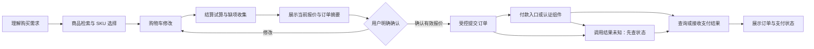

# 聊天式购买链路：接入评估与建议决策

日期：2026-10-28。本文保留最初方案评估及后续真实供应商接入要求。本地公共 Cookie 访客与 mock 购买框架已实现并通过本轮有限验收，当前合同见[公共访客与聊天式模拟购买](public-commerce.md)；尚未部署或接入真实交易。

前提：商品检索、商品/SKU详情、购物车、订单创建、支付及订单状态等业务接口已有外部实现。本项目承担对话理解、流程编排、用户确认、调用授权、状态恢复和结果展示；电商系统仍是库存、价格、订单与付款事实的权威来源。未调用真实交易接口，本文件不表示某个平台已接入或通过验收。

## 结论与最小交付

建议采用 **Agent 导购与对话 + 服务端购买流程状态机 + 外部 Commerce Adapter**。在现有应用内新增购买模块即可，不需要先拆微服务或建立独立多 Agent 系统。

可按接入深度分期，不要求首期实现全部链路：

| 层级 | 聊天内交付 | 适用边界 |
| --- | --- | --- |
| A：导购与结算交接 | 找商品、确认 SKU/数量、加购、提供外部结算入口 | 首期可选；最终核价、确认和建单在商家页面完成，仅交接成功不能显示购买成功 |
| B：聊天确认下单 | 在 A 基础上增加试算摘要、聊天确认、受控建单、付款入口及权威状态恢复 | 推荐目标；外部接口需具备条件提交、幂等和结果找回契约 |
| C：体验扩展 | 内嵌支付组件、复杂优惠、多地址或多商家 | 后续按实际需求扩展 |

默认付款由外部可信结算页面完成认证；若已有支付接口提供受控的内嵌组件，可让组件承载付款认证。两者均由后端核实订单和支付状态，模型不接触支付密码、银行卡验证码等凭据。商品规格、收货信息、优惠、总金额和支付授权须在明确界面核对；「帮我看看」「加入购物车」「确认下单」「同意付款」分别授权不同动作。

设计参考：Shopify Storefront 提供 cart 到 checkoutUrl 的交接；UCP 的 checkout 生命周期也区分信息未齐、待买家操作、可完成、处理中与已完成，并要求可信结算界面。这里借鉴状态与交接原则，不要求外部接口实现某一协议。[Shopify cart/checkout](https://shopify.dev/docs/storefronts/headless/building-with-the-storefront-api/cart/manage)，[UCP 2026-04-08 checkout](https://ucp.dev/2026-04-08/specification/checkout/)。

## 选择比较（ADR）

| 方案 | 收益 | 代价 | 评估 |
| --- | --- | --- | --- |
| 全由模型自由调用底层 API | 接入原型快、对话灵活 | 确认、重试、支付中断和多轮状态容易不一致 | 适合探索工具，不作为购买提交路径 |
| 全固定向导 | 状态容易验证、行为明确 | 导购、比较、插问、改需求体验僵硬 | 可用于最终核对和授权界面 |
| Agent + 受控购买流程 | 自然对话与交易约束可分别验证 | 需要持久流程状态与适配层 | 推荐 |

本地 mock 实现采用第三种方案。代价是增加领域状态、版本和事件处理；收益是业务规则可在不调用模型时验证，故障恢复无需重演模型推理，外部电商接口可替换。

## 一条链路如何运行

示例只是对话流程，不代表真实报价：

1. 客户：「找一款 500 元以内的降噪耳机。」Agent 调商品搜索，再取得候选的可售 SKU/现价/属性；有歧义就问用途或规格。
2. 客户：「第二款黑色，两副。」Agent 解析候选引用，服务端验证 SKU、数量与权限后修改当前购物车，展示外部接口返回的购物车。
3. 客户：「可以退货吗？」通过 RAG 查询政策并回答，购买流程停留在购物车阶段，后续可继续。
4. 客户：「就这些，配送到默认地址。」服务端只使用本人已授权的地址引用，取得运费、税费、优惠和最终试算；不能直接把商品列表价格当应付总额。
5. 聊天展示结构化结算摘要，客户确认此版本的商品、数量、配送和总价。确认后才创建订单；接口若把下单和付款合并，则界面必须明确说明本次确认会执行的动作。
6. 展示「订单已创建，待付款」及可信付款入口。客户完成支付认证后，聊天查询或接收外部结果，显示「支付处理中」「支付失败」或已核实的「支付成功」。

Agent 每轮只完成当前能做的推进，缺信息、确认或付款认证时结束本轮等待。整个购物过程跨多轮持久化，不依赖一次模型长循环跑到底。

在现有 LangGraph 内，每轮读取本人 PurchaseSession，解析本轮命令，由 PurchaseService 执行允许的一步或有界步骤，保存进度与展示结果后等待下一轮。政策插问走原 RAG 路径，购买记录保留，继续时重读当前状态；普通跨轮 API 即可推进，不必强制采用 interrupt 或另一套工作流平台。checkpoint/interrupt 可帮助对话暂停和恢复，但不能代替交易记录或外部幂等：LangGraph 恢复 interrupt 所在节点时会从节点开头重跑，写入仍须通过购买服务的执行约束。[LangGraph interrupts](https://docs.langchain.com/oss/python/langgraph/interrupts)。

## 编排层与模型的边界

| 阶段 | Agent 负责 | 服务端及外部系统负责 |
| --- | --- | --- |
| 选品 | 理解预算、用途、偏好；比较与澄清 | 商品/SKU真实性、可售范围、库存、实时价格 |
| 加购 | 把明确购买意图解析成商品与数量 | 当前用户购物车归属、参数校验、幂等修改、版本冲突 |
| 试算 | 收集缺少的信息、解释接口结果 | 运费、税费、折扣、币种、库存重新校验、报价有效期 |
| 确认 | 提示需要确认的内容 | 生成不可变摘要和 confirmation_id，决定可执行动作 |
| 下单 | 表达客户要提交的意图 | 校验确认对象、绑定订单创建操作、调用外部 API |
| 付款 | 解释下一步，显示受控操作入口 | 支付认证、扣款及最终状态；禁止由模型提供金额/付款凭据 |
| 跟进 | 理解「刚才付了吗」「订单到哪了」 | 根据本人 purchase/order/payment ID 查询并返回事实 |

商品描述、评论、检索资料都作为数据输入，不能扩大工具权限。RAG 适合政策与使用说明；实时价格、库存、订单和付款结果由业务 API 提供。

## 工具按业务动作封装

不需要将外部每个 HTTP 方法都直接暴露给模型。建议先提供：

| 工具 | 主要入参 | 返回 / 约束 |
| --- | --- | --- |
| search_products | query、filters | 候选 product/variant ID 与属性；结果范围有界 |
| get_product | product_id | SKU、可售状态和当前展示信息 |
| set_cart_line | variant_id、quantity、expected_cart_version | 本人购物车快照；尽量使用设置数量而非可重复累加 |
| get_cart | purchase_id | 服务端关联的外部 cart 快照 |
| prepare_checkout | purchase_id、地址/配送引用 | quote_id/version、金额/币种/费用、缺项、有效期 |
| commit_checkout | confirmation_id | 服务端读取已确认快照；不给模型重传金额/SKU/地址的权力 |
| get_purchase_status | purchase_id | 外部订单与支付状态、下一步操作 |

创建付款会话可由服务端在确认订单后按固定规则调用，未必需要再给模型一个任意 charge 工具。接口若允许余额支付等直接扣款，需独立、明确的支付授权和外部认证，不能从「确认下单」推导出扣款许可。

外部流程可以先建待付款订单，也可以在 Complete Checkout 时才生成订单。适配层选择唯一的订单提交入口，映射到一致的本地阶段；不能同时调用独立 create_order 和一个本身也会建单的 checkout completion，造成两次购买。

工具只在当前阶段按白名单提供；每个 handler 仍检查状态与权限，不能只靠不向模型展示某个工具。外部 API 是 REST、GraphQL 还是 MCP 不改变这些规则。

## 最少需要保存的购买状态

建议独立 PurchaseSession，Chat/LangGraph checkpoint 只引用 purchase_id：

- 身份：merchant/tenant、认证 user、稳定 purchase_id；当前聊天 session_key 仅绑定本次对话操作，清空聊天不会取消外部订单。
- 购物车：cart_id、cart_version、选定 SKU/数量、必要的地址及配送引用。
- 报价：quote_id/version、有效期、金额最小币种单位与 currency、需用户确认的字段摘要。
- 授权：confirmation_id、授权动作、摘要 hash、确认人、有效期、是否已消费。
- 业务对象：external order_id、payment_session_id/attempt_id、最后可信状态和查询时间。
- 执行：operation_id、外部幂等键、request hash、提交状态及版本；结果未知时保留待核实标记。

外部 cart/order/payment 对象拥有最终事实；本地保存关联与编排进度，必要时重读外部对象。conversation checkpoint、assistant 消息和浏览器 storage 都不充当订单数据库。对话中断、换设备或人工接续应通过认证用户重新取得本人活动购买记录，再明确恢复。

首期可限制同一用户与商家只有一个活动结算提案，并提供账号级「继续购买 / 待付款订单」入口；多个设备读取同一记录、共享版本。转人工时暂停 Agent 的购买写入，移交 purchase/quote/operation 引用和待核实状态；客服仍经过同一领域守卫。客服工单权限不包含替用户确认下单或付款的授权，最终确认与支付认证仍由购买用户完成。

流程至少区分：选品、购物车、试算待补充、待确认、订单提交中/结果未知、待付款、需支付认证、支付处理中及终态。订单状态和支付状态分别保存；有订单号不等于已付款，用户说「我付了」只触发查询，不能更改支付事实。订单已创建后再修改商品或地址，需要明确走已有订单变更/取消流程；不能为了继续购物而暗中再创建一单。

## 确认、版本与失败处理

确认绑定服务器生成的摘要：购买用户/商家、purchase/cart/version、SKU/数量、收货/配送引用、quote/version、应付金额/币种和到期时间。客户端提交 confirmation_id 与版本，服务端重新授权、核实报价资格后执行。

如果外部价格、运费、库存或地址发生实质变化，原确认失效并展示新报价。下单接口应原子接受 quote/version 或等价的商品与金额条件；本地在提交前再查一次价格，不能单独消除查价与下单之间的竞态。外部不支持条件提交时，最后核价与下单授权应交给商家结算页，不声称本地快照能锁价。语义相同的「确认」不能独立确定是哪一单；有多个提案时必须明确选择。按钮确认优先，纯文本确认只绑定唯一仍有效且处于当前对话上下文的服务器提案。「好的，换黑色」应修改并重新报价，不能提交旧提案；插问后的「好的」若含糊则澄清。

PurchaseService 在本地事务中按 purchase/version 做 CAS，消费确认并将待确认变为提交中，绑定唯一 operation；数据库约束同一购买提交代际只能存在一个建单操作。不同标签页、会话或 confirmation/action ID 的提交也必须归并到该操作，不能仅按 action_id 去重。各外部写入均先绑定购买版本与稳定操作身份；同一订单的付款 attempt 仍在 processing/unknown 时，先查询原 attempt，不直接新增可扣款尝试。更换付款入口须依据供应商明确的失败、终止或替换语义。

| 事件 | 确定性处理 |
| --- | --- |
| 商品缺货 / 规格不明确 | 保留购物车，明确缺项或候选，客户重新选择 |
| 报价过期 / 条件变化 | 重新试算并再次确认，不复用旧授权 |
| 重复点击或重复确认 | 同一 operation_id 重放结果，不新建订单 |
| 下单或付款调用超时 | 进入 unknown/pending，按原请求 ID 查询；不换新 key 盲目重提 |
| 已下单、付款会话创建失败 | 保留原订单，恢复付款入口或查询原付款会话，不重建订单 |
| 用户退出付款页面 | 保持待付款/待查询，退出页面不代表取消或支付失败 |
| 支付通知重复、迟到或乱序 | 验证来源、去重并核对关联对象；必要时重读权威状态 |
| 用户取消聊天任务 | 停止后续编排；撤销已创建订单/付款需外部明确操作和独立确认 |

当前执行账本可保护一次已保存提案，但并不提供外部 exactly-once，也没有完整交易对账状态机；其 lookup 还要求原 live_session_id，删除聊天后不能直接用于跨会话恢复。购买域须独立保存 purchase → operation → 外部 request/idempotency key/业务对象的稳定映射；聊天 session_key 约束本次操作，清空或删除聊天不能释放原建单唯一性或未知状态，已创建订单仍可由本人重新授权查询。只有在供应商契约允许时才安全重试原请求。Stripe 的幂等文档也明确区分 API v1 与 API v2 对失败请求的重试语义，不能把接口返回或本地 completed 一律当交易成功。[Stripe 幂等请求](https://docs.stripe.com/api/idempotent_requests)。

付款返回页只负责触发状态核实。通过受信 webhook 与主动查询更新状态，避免以浏览器跳回或聊天结束认定付款成功；外部若没有 webhook，可先用有界查询加恢复入口，仍需准确区分未确认。Stripe 文档同样要求监听异步支付结果，不能仅依赖 landing page。[Stripe 支付后处理](https://docs.stripe.com/payments/existing-customers?platform=web&ui=stripe-hosted)。

## 实现前的代码评估（历史基线）

可复用：

- [AgentService](../../app/services/agent/service.py)：已有有界 tool loop、历史上下文和人工升级入口。
- [ToolRegistry](../../app/services/dialogue/tools.py)：已有 schema 导出、服务端身份注入、确认门、authorize 钩子与执行账本接入。
- [ActionLedger](../../app/services/dialogue/action_ledger.py)：已有持久占位、原结果重放、未知不重抢。
- [DialogueState](../../app/services/dialogue/state.py)、会话协调与消息持久化：可承载流程引用和对话连续性。

必须补的内容：

1. 购买入口路由与领域状态。当前 TASK_INTENTS 是退款/退货/查订单/物流/投诉，没有 shopping；需同步适配意图分类、提示词与 slot fallback。现有 task_executed 是单任务终态，不等于跨多轮购物进度。
2. Commerce Adapter 与 PurchaseService：把外部字段、错误和状态规范化，集中处理购物车版本、报价、确认、下单和查询；先作为现有应用模块。当前 ToolRegistry 按 intent 唯一存储，多个工具都注册为 shopping 会互相覆盖；可采用 commerce:search_products、commerce:commit_checkout 等独立工具键，与上层 shopping 路由分开，或显式扩展工具索引。
3. 购买专用确认摘要与恢复：当前 pending_confirmation 是单条工具提案，模板直接展示 slot=value；不能直接当成商品、费用、地址、授权范围完整的结算确认。
4. 多阶段执行：Agent 默认最多 3 个模型轮次，确认工具会结束当前 Agent run；确认后现路径生成回复，没有持久购买阶段推进器。需要跨轮次的确定性流程推进，而非单纯提高循环次数。当前 Agent 异常可回退 slot pipeline；购买写入可能已发生时，回退只能查询原 operation、澄清或交接，不能重新提交。
5. 订单/付款结果约束：ToolResult.success、账本 completed、HTTP200 与 assistant completed 都不是已付款；需领域状态和受控回执文案。
6. 购买 UI 与持久历史。当前工作台主要渲染普通文本、引用和 AI 反馈，没有商品/SKU、购物车、结算确认及付款 action block；普通文本 URL 也不会自动成为按钮。
7. 外部账户与委托授权。当前 authorize 钩子只在确认写入且配置账本的分支调用；读取购物车/订单等也必须由适配层检查归属。MCP facade 会剥离 user_id，但没有逐账户凭据桥，且 session_id/language 等参数仍可能转发；外部购买用户、商家和购物车授权映射要显式实现，不能把模型参数、内部数字 ID 或通用 MCP 配置当供应商授权。

无需先采用多 Agent 拆分。一个 Agent 处理当前客户对话，购买状态机控制写入；后续只有商品规模、跨商家和复杂服务确有需要时再拆推荐/比价等子能力。

## 前端最小改动

REST 先扩展版本化 ui/actions，保留现有 content 和 citations 兼容：商品候选、购物车摘要、结算报价/确认、付款操作、订单状态。操作来自服务端的 action_ref/confirmation_id，绑定 purchase/quote/version/当前用户、session_key 和 expiry，不从模型生成的任意 HTML、金额或 URL 执行。message_id 继续表示 assistant 与反馈身份，不充当商品、订单或授权操作 ID。

最简页面只需选中商品的文字摘要、购物车/结算摘要、确认按钮和经过校验的付款链接；商品图片、多规格组件、内嵌支付和 SSE 分块可后续增强。付款入口必须来自已接入业务接口，使用 HTTPS 和允许的 origin，或经己方受控的 opaque redirect 解析。模型仅得到待付款状态及操作说明，付款凭据、敏感付款 token 和不必要的 checkout URL 不进入模型上下文；点击时可由授权 action_ref 解析有效入口。返回可点击链接依然要增加可信 action 渲染。

历史保留当时显示的快照，旧 action 需要重新校验或禁用，不能渲染即 POST；商品/报价不是知识库 citations，AI thumb feedback 也不是付款凭证。若扩 SSE，再引入独立、opt-in 的结构化事件，并在最终事件与对应 session/receipt/明确 DONE 匹配后启用操作，不让部分文本提前激活按钮。

## 外部接口需要核对的最小契约

「有接口」之外，适配前确认：

- 用户及商家授权如何映射，cart/order/payment 查询是否校验归属。
- SKU、数量和价格单位、币种、税费/运费/优惠的权威字段。
- 报价或 cart version、TTL、库存保留与下单重新验证语义。
- 下单/付款是否可接受稳定客户端请求键，超时后如何按该键找回唯一业务对象。
- 下单与扣款是分开的还是一个调用；付款状态与下一步认证操作如何返回。
- webhook、查询与错误码是否区分拒绝、未执行、处理中和结果未知。

缺少对账查询或可靠幂等时，采用 A 层受控结算交接，不启用 Agent 直接提交及自动恢复承诺。已经发生的 unknown 持久保留待核实或人工核实入口，不能按 TTL、聊天重建或再次确认自动解锁重提。

## 实施顺序与验收

1. **契约与模拟旅程**：整理上述契约，实现 CommercePort 与确定性本地假接口，只用于验证购物编排，不建设商品/订单/支付后台。先通过真实 Agent 对话到报价确认，包含插问与修改规格。
2. **按深度接入**：先选 A 层导购与外部结算交接，或在契约充分时接 B 层聊天确认、外部建单与付款入口、查询恢复。限单商家、单币种、一个活动购物车/结算提案；可先只支持单 SKU、数量、已有地址或商家页面填写地址。订单修改/取消与复杂优惠暂由商家或人工处理。
3. **上线可靠性与体验**：供应商 sandbox 验证幂等/回调/状态，故障注入、真实浏览器认证回跳、权限/并发与监控；随后扩优惠、多地址、内嵌支付或多商家。

每阶段分别报告模拟编排与真实供应商证据。已有外部 API 时，开发量集中在上述 7 个本地集成点；接口真实语义和 UI 要求未核对前，不给确定工期或宣称开箱即用。

关键验收包括：需求歧义先澄清；自然语言引用到正确 SKU；中途问政策后继续原购物车；修改规格/地址后旧确认失效；超时不重复建单/付款；支付认证中断可恢复；外部通知重复不重复推进；换账号/重建会话不使用旧授权；下单、待付、处理中、已付文案分别对应事实；刷新与回到聊天不自动提交。

评价成功应看正确 SKU/金额的下单完成率、已核实支付率、确认后修改率、恢复成功率与重复交易数。它们独立于现有客服 containment/用户解决证据指标，不能用「聊天回答结束」代替购买成功。
