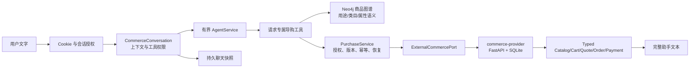

# 公共访客与 Agent 纯文本模拟购买

日期：2026-10-29。本文描述当前代码目标：购物语义由 provider LLM Agent 独占，商品与交易事实由独立内部虚拟 commerce provider 提供。无真实扣款、真实配送或商业支付接入。

## 目标与边界

- 项目目标是验证 **Agent 自动导购编排链路**：多轮理解、工具选择、参数绑定、多商品购物车、交易状态推进、插问恢复和故障后原操作恢复。
- 商品、库存、限购、多行购物车、报价、订单和支付事实由独立 `commerce-provider` 服务拥有；它用确定性生成的 100,000,000 个可寻址 SKU 和 SQLite 事务模拟成熟外部 API，不把目录全量枚举进内存或聊天库。
- 每个购物事实回复都向访客声明：商品与交易事实来自独立内部虚拟商城 API，下单与付款仅模拟，不产生真实订单或扣款；不把“模拟交易”表述成“商品数据由模型编造”。
- 下单与付款是两次独立、明确、新鲜的文字授权；模型不能自行绕过服务端授权门。
- `COMMERCE_PROVIDER_MODE=external` 是显式组合选择。HTTP provider 超时、拒绝或不可用时，购物显式失败/提示稍后查询，不会静默退回本地 planner 或本地 mock。

## 身份与数据归属

`POST /api/v1/guest/bootstrap {}` 签发 `rag_guest_session` Cookie，返回访客 UUID、到期时间、私人咨询 ID 和 `session_key`。浏览器持有 Cookie 即代表这位访客，不绑定现实个人；清除 Cookie 后不能凭旧咨询 ID 恢复身份。

Cookie 为 HttpOnly、Secure、SameSite=Lax、Path=/ 的 session cookie。服务端默认七天有效，可通过 `GUEST_SESSION_TTL_SECONDS` 调整；本地 HTTP 才可设置 `GUEST_COOKIE_SECURE=false`。数据库只保存随机令牌 SHA-256。

访客使用内部 `User.is_guest` 主体复用整数 owner，但不能成为管理员。所有请求使用 `credentials: include` 和 `X-Rag-Guest: 1`，写请求核对 Origin。`session_id + session_key` 只定位咨询，Cookie 才是身份；HTTP 与会话门闩内再次核对 owner、private 标记和当前 key。访客路径不采信 body/model 的 `user_id`。

凭据失效返回 401，前端清除旧上下文，由用户明确重新开始；身份存储故障返回 503，不签发替代访客。消息历史仍是 best-effort，不能以空历史判断交易不存在；购买状态由 provider 回执和本地 operation 记录核实。

## Agent 与 provider 边界



- `CommerceConversation` 在每轮构造请求局部工具 registry，不向旧共享 Demo 图注册购买工具。接受购物任务后先持久提升 automation epoch，再调用模型或工具；模型失败、请求取消或聊天保存失败不能复活旧退款提案。
- `AgentService` 负责理解、规划和实际工具调用：请求是否购物、买什么、约束是什么、候选页中“1号/第二款/便宜的那个”指哪个、如何拆成多行、是否追问、是否足以授权，均由模型判断。
- 常规工具：商品知识图谱语义查询、类目发现（标准类目与允许属性值）、结构化商品搜索（价格/属性/库存过滤、排序、分页）、SKU 详情、多行购物车更新、试算、状态查询。
- 受控工具：`commit_checkout` 与 `mock_pay` 只在当前阶段匹配且最新展示版本有效时注册；handler 再核对 owner、purchase、version、confirmation/payment 和 generation。模型传入 owner、金额、付款成功标记或外来 idempotency key 无效。
- 一回合最多推进一个不可逆阶段。模糊确认、否定、疑问或组合的“确认下单并付款”均只澄清或查询，不写入。
- 购物目录轮回复采用两层投影：模型可解释已检索事实并给出预算内组合建议，但必须标注尚未加购；权威 SKU、价格、库存、限购仍来自服务端 `CommerceView`。购物车、报价、订单、付款阶段不接受模型自由文本，模型不能宣布交易成功。

## 开放式需求与类目发现

- commerce provider 通过 Bearer 保护的 `GET /commerce/categories` 暴露权威类目事实：25 个标准类目的 id、名称、描述和允许属性值。用户语言别名仍是 provider 内部检索索引，不进入语义层，也不作为可配置路由表。
- 面对开放式需求（例如“预算 1500 配一个远程办公角落”），LLM Agent 先发现 taxonomy，再把需求映射到一个或多个标准类目并逐类搜索；不存在确定性查询重写器。
- `create_commerce_tools()` 的请求局部状态按 `sku_id` 去重；不同查询跨类目轮转均衡，同一查询的分页结果并回原 provider 顺序。每轮可见 typed 候选总数硬上限为 5 个。第一次搜索保持单查询分页语义；后续搜索返回一个合并目录块和最新非目录块。合并只做展示层收敛，不替模型决定类目或搜索顺序；不同查询的 page token 不能合并，因此合并视图不带 `next_page_token`，但保留 provider 总量估计并提示可换一批。
- 模型组合建议只能引用当前合并候选块中仍展示的 SKU；购物车、报价、订单和付款仍以服务端事实为准。
- 整体预算是组合总价约束，不是固定类目配额。除非用户明确给出单项/类目价格上限，LLM 不得在类目搜索上自行设置 `max_price`；先取完整候选，再在组合层控制总价。带筛选搜索为空时必须先去掉非用户筛选复搜，才能说明缺候选。
- Agent 内部上限为 `max_steps=6`，每请求 LLM 预算仍为 `CHAT_LLM_CALL_BUDGET=8`；公开 IP/聊天限流不变。该上限只放宽规划轮数，不放宽滥用控制或交易确认门。

## 商品知识图谱

- 复用项目既有 Neo4j/GraphRAG 基础设施。API 启动时把 provider taxonomy 投影为 `CommerceCategory`、`CommerceAttribute` 节点和 `HAS_COMMERCE_ATTRIBUTE` 关系；不复制任何 SKU、价格、库存、限购或用户 alias。
- 商品投影写入是原子替换：只删除带 `Commerce*` type 的投影节点/关系后重建，不触碰文档知识图谱；LLM 每次推断出的用途集合不会在重启间无限累积。
- LLM 语义规划器从标准类目推断 `CommerceUseCase` 节点（如家庭影音、远程办公、移动差旅），并用 `SERVES_COMMERCE_USE_CASE` 连接相关类目。该推断是模型语义，不是固定短语表；输出只允许 provider 已有 category id。
- 购物 Agent 获得只读 `commerce_graph_context` 工具，可用于理解用途、搭配、替代和跨类目关系。图谱结果永远标注 semantic-only；SKU、价格、库存、限购和可购买性仍必须由 commerce provider 工具验证。
- Neo4j 不可用、投影失败或图谱为空时购物不降级到规则路由；Agent 仍可用 `discover_catalog` 和 provider 搜索。图谱工具调用与所有 Agent 工具一样进入 `cs.tool` 实时 trace。
- 普通 support GraphRAG embedding 检索排除 `Commerce*` 投影节点，避免商品语义污染客服知识答案；购物侧通过显式 `entity_types` 只查商品投影。

## Provider 事实与本地编排状态

外部 provider 独立拥有：

- 100,000,000 个稳定可寻址 SKU、价格、库存、限购和属性；
- 结构化搜索、过滤、排序和有界分页；
- 多行购物车和乐观版本；
- 报价、有效期、报价/购物车版本一致性；
- 订单创建、库存扣减、quote 消费；
- payment intent、模拟支付、processing/paid/failed 状态；
- 按稳定 `request_key` 的幂等回执和 operation lookup；
- 测试专用 reject、unknown-after-commit、processing 故障注入（仅在显式启用时暴露）。

本地 `commerce_purchases/operations/confirmations` 只保留非语义安全编排：owner 绑定、会话活动购买、展示版本、不可变报价确认、operation 幂等键、unknown 后 lookup 和审计。历史 `commerce_actions` 表保留生产数据但运行时不再读写。provider 的 SQLite 状态位于 Docker volume `commerce_provider_data`，与主 PostgreSQL 备份分开，必须单独备份；清空聊天不取消 provider 订单或付款。

## HTTP 与前端契约

|请求|用途|
|---|---|
|POST `/guest/bootstrap`|Cookie + visitor_id/expires_at/session{id,session_key}|
|POST `/guest/chat`、`/guest/chat/stream`|商品、购物车、报价、下单、付款、查询的唯一公开入口|
|GET、DELETE `/guest/history`|核对原 key；清空轮换 key，不清购买|
|POST `/guest/feedback`|绑定真实完成消息及当前咨询 key|
|GET `/guest/commerce/purchases/active`、`/{purchase_id}`|服务端/测试用只读状态核实，不向前端提供操作|

`commerce-provider` 只监听内部 Docker 网络，不发布宿主端口；API 通过 `ExternalCommercePort` 和 Bearer token 访问。`CommerceView` 仍是服务端事实投影，没有 actions/action_ref。前端不解析该结构，也不发起购买专用 POST。

SSE 从消费者消息入口开始输出 `event: trace`：provider 路由（含 `intent`、`confidence` 与 router）、Agent 每轮模型调用、每个工具、最终 outcome 和错误都必须实时进入 Execution Chain；购物接管不是普通对话图的观测例外。文本帧、可选持久化 completion 和 DONE 随 trace 之后输出。completion 必须匹配原 session_key；没有有效 completion 时不显示普通“接收完成”，只提示聊天保存未确认、交易状态需查询。聊天保存失败不回滚业务，也不虚构 message ID。

## 千万变体边界

购物自然语言变体空间开放且千万级以上，不能穷举覆盖。新增一个短语不得要求新增正则、固定话术、候选映射或状态迁移；穷举规则和穷举测试不能证明语义完备。未见输入、错别字、口语、混合语言、多意图和长上下文由 LLM Agent 泛化、追问或安全拒绝；模糊时不得写交易。自动化测试只验证编排、类型、授权、幂等和恢复，真实模型质量需分层抽样和 held-out 评测估计。

## 验证

定向命令：

```sh
.venv/bin/pytest --no-cov -q app/tests/unit/commerce_provider \
  app/tests/unit/services/commerce \
  app/tests/evaluation/test_guest_commerce_flow.py \
  app/tests/evaluation/test_commerce_task_fencing.py \
  app/tests/evaluation/test_guest_conversations.py
```

覆盖 provider catalog/address space、taxonomy 发现、类目属性 wire contract、外部/mock 等价、开放式需求多类目搜索、跨搜索候选去重、别名表禁用、多行 cart、报价/订单/支付、幂等冲突、unknown-after-commit、SQLite 重开持久化、owner 隔离、HTTP wire contract、Agent 工具循环、两次独立文字确认、重复确认幂等、跨访客隔离、报价过期、购物车变更、政策插问恢复、processing 和消息保存失败。完整门禁结果以最新部署记录为准。2026-10-29 生产浏览器 canary 用“预算1500配置远程办公角落”验证：最终回复包含标注未加购的组合建议与权威候选事实，覆盖显示器、键盘、鼠标、耳机、摄像头、人体工学椅等类目；消息 metadata 为 `planner_mode=provider`，工具审计含 1 次 `commerce_discover_catalog` 与 6 次 `commerce_search_products`，无模型自造 `max_price` 筛选，且浏览器未发起购买 mutation 请求。

本合同不宣称真实支付、真实供应商、生产并发/容量、跨副本 Cookie 拓扑或浏览器支付认证。原[接入评估](conversational-commerce-assessment.md)保留历史设计；其中的按钮/结算页建议已被本文纯文本合同取代。
