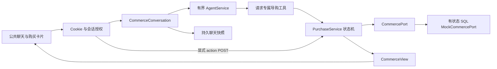

# 公共访客与聊天式模拟购买

日期：2026-10-28。本地实现，未部署；验收结果见[购买链路记录](../reviews/public-commerce-results-2026-10-28.json)及[可靠性里程碑](../reviews/public-purchase-milestone-2026-10-28.md)。当前面向公共网站，无需注册。已有 `/support/` 保留，本轮不继续建设工作台功能。

## 身份与数据归属

`POST /api/v1/guest/bootstrap {}` 签发 `rag_guest_session` Cookie，返回访客 UUID、服务端到期时间、私人咨询 ID 和 `session_key`。浏览器持有 Cookie 即代表这位访客，不绑定现实个人；不同浏览器或清除 Cookie 后无法凭旧咨询 ID 恢复身份。

Cookie 为 HttpOnly、Secure、SameSite=Lax、Path=/ 的 session cookie，无 Domain、Max-Age 或 Expires。服务端默认七天有效，可通过 `GUEST_SESSION_TTL_SECONDS` 调整；浏览器恢复上次会话可能保留 Cookie，最终仍以服务端有效期为准。本地 HTTP 才可设置 `GUEST_COOKIE_SECURE=false`。服务端只保存随机令牌的 SHA-256，JSON 不返回原始令牌。[Set-Cookie](https://developer.mozilla.org/en-US/docs/Web/HTTP/Reference/Headers/Set-Cookie)、[OWASP session management](https://cheatsheetseries.owasp.org/cheatsheets/Session_Management_Cheat_Sheet.html)。

访客使用内部 `User.is_guest` 主体复用已有整数 owner，但 email/password 均为空，数据库约束其不能成为管理员；登录、刷新和注册账户查询排除访客。这是内部授权主体，不是为访客生成注册账户。`GuestVisitor` 关联主体、令牌散列、有效期和当前咨询。

所有访客请求使用 `credentials: include` 和 `X-Rag-Guest: 1`，写请求另核对 Origin。`session_id + session_key` 只定位咨询，Cookie 才提供身份；HTTP 与门闩内再次核对 owner、私人标记及当前 key。访客路径不继承旧 Demo 共享会话例外，不采信 body/model 的 `user_id`。生产前后端需使用可发送此 SameSite Cookie 的同站点拓扑；CORS allowlist 不会解除浏览器 Cookie 限制。

普通请求凭据失效返回 401，前端清除原私有上下文，由用户明确重新开始；访客身份读取或初始化不可用返回 503，不把身份存储故障当新访客。bootstrap 可在令牌失效时签发新的访客，前端不会将旧交易自动重发。消息历史仍复用既有 best-effort 读取，独立消息查询故障可能返回空列表；不能以一次空历史判断交易不存在，购买恢复使用独立购买查询。

## 框架分工



- `CommerceConversation` 为经过 Cookie 认证的公共请求创建本轮工具 registry；不向旧共享 Demo 图全局注册购买工具。政策插问继续走既有 RAG；购物进度保留在独立购买表中。接受新购物任务后，先在会话门闩内持久切换 automation epoch，再读取购买上下文、调用模型或执行购物工具。模型报错、请求取消或聊天记录保存失败，均不能让先前的退款待确认提案复活。隔离写入失败时停止购物执行；已发生业务的撤销仍需独立业务流程。
- `AgentService` 使用同一有界工具循环，可接 provider planner，未配置或 provider 不支持工具调用时使用确定性虚拟 planner。虚拟 planner 调真实 handler 和 SQL mock，不直接生成“已下单”假事实。当前虚拟理解范围有界；规格含糊应由卡片选择。候选顺序从当前咨询最近的同版本持久快照恢复，价格、库存与写入版本仍以当前领域事实为准。
- 模型只获得检索、详情、设置 SKU/数量、试算、查询工具。下单确认和模拟付款只能通过服务器生成的 action_ref 从显式按钮进入，不存在模型可调用的 commit/pay 工具。回复和 UI 由领域结果生成，模型自由文本不能宣布订单或付款成功。
- `PurchaseService` 持有报价快照、有效期、版本 CAS、确认消费、原操作幂等身份和结果核实。聊天消息、HTTP 200、assistant completed 均不表示支付成功。
- `CommercePort` 定义外部业务契约。当前只允许 mock 模式适配器；接真实系统前必须显式扩展认证、模式和支付授权契约，不能替换 adapter 后继续展示“不扣款”。

## 持久状态与恢复

新增六张购买域及 mock 供应商表：`commerce_purchases/operations/confirmations/actions/mock_objects/mock_receipts`。购买只关联 owner，不依赖 ChatSession 外键；清空或删除聊天不取消订单、释放未知请求或移除供应商事实。

同一访客与商家最多一个活动购买。阶段包括 shopping、cart、quoted、submitting、unknown、awaiting_payment、processing、paid、failed。只有核实已付后才释放活动位置，开始下一笔购买；当前为单商家、CNY、单 SKU、数量 1–10，模拟配送无需真实地址。

购物车变更先校验版本；试算形成不可变报价与 confirmation。确认按 purchase/kind/generation 预占唯一 operation，提交事务后才调供应商，以稳定 request key 查找结果。mock 供应商使用独立事务保存购物车、库存、订单、付款与幂等回执；接受后超时能留下真实的本地“不知道是否完成”窗口。

unknown/processing 不更换 key 重试、不按 TTL 释放购买。GET 可以查询并核实原操作，不能暗中创建订单或付款入口；例如建单超时后查到订单，界面提供明确的“继续生成模拟付款入口”，等待新的按钮动作。模拟付款也单独确认。报价过期、旧版本和外来 action 均拒绝。

历史 UI 是当时快照，只读展示。恢复按钮 GET 当前本人购买后才启用新动作；每个动作绑定原服务器 ref/version，客户端不能提交金额。HTTP 重试审计同时绑定 ref、purchase、原 version 和 quantity，改变输入不能取得旧成功回执。业务去重以领域 operation 为准，不依赖临时 client_request_id 或聊天消息仍存在。

明确按钮动作也先核对 owner、咨询 key、ref 归属、原描述版本及重试输入，再持久隔离旧任务，最后执行领域操作。领域操作可能已经提交后再抛错，任务隔离因此不能放在成功回执之后。被拒绝的外来 owner、旧 key 或篡改描述版本不切换任务。合法售后流程本身的确认仍由原 RAG 处理。

浏览器对购买 GET/POST 设置 30 秒等待期限，覆盖响应头与 JSON 正文，包含顶层“继续模拟购买”查询。超时或调用方取消结束本次等待，保留交易结果待核实状态；不会自动重发订单或付款。卡片刷新时先撤销该卡已有的可执行状态，只有本次 GET 成功后才重新启用动作。顶层 active 查询失败不广播撤销其它独立卡片，其 ref/version/有效期仍由服务端检查。客户端结束等待不会撤销服务端已经执行的交易，迟到 ACK 不更新当前界面。

## HTTP 与前端契约

| 请求 | 返回与用途 |
| --- | --- |
| POST `/guest/bootstrap` | Cookie + visitor_id/expires_at/session{id,session_key} |
| POST `/guest/chat`、`/guest/chat/stream` | 必填 session_id/expected_session_key；购物与普通客服共用聊天入口 |
| GET、DELETE `/guest/history` | 核对原咨询 key；清空轮换 key，不清购买 |
| POST `/guest/feedback` | 绑定真实完成消息及当前咨询 key |
| GET `/guest/commerce/purchases/active`、`/{purchase_id}` | `{session_id,session_key,ui}`；恢复当前或最近购买 |
| POST `/guest/commerce/purchases/{purchase_id}/actions` | ref/version/client_request_id + 可选 quantity；返回当前 ui 和可空 message_receipt |

CommerceView 为 schema_version=1、mode=mock、purchase_id/version/stage/snapshot_at、判别 blocks 与 actions。block 包括 catalog/cart/quote/payment/status，金额使用整数分。action_ref 是不透明服务器引用，不接受模型 HTML 或任意付款 URL。

SSE 保持文本帧、可选已持久化 completion（包含原 session_key）和 DONE。前端收到有效完成回执后回读历史取得 UI；部分流不会激活交易按钮。动作消息保存失败时仍返回真实购买状态，但 message_receipt=null，不伪造反馈 ID 或把已发生的领域动作描述成回滚。

## 验证与后续边界

可用现有虚拟环境单独验证公共 HTTP/Agent 旅程，无需调用真实模型或交易接口：

```sh
.venv/bin/python -m pytest app/tests/evaluation/test_guest_commerce_flow.py app/tests/evaluation/test_guest_conversations.py --no-cov -q
```

该命令只跑专项，不代替保留 70% 核心覆盖门槛的完整 `.venv/bin/python -m pytest`。

本轮覆盖真实本地 SQLite/HTTP/Agent 工具循环、身份隔离、历史恢复、明确确认、重复提交与 mock 接受后超时。测试阻断外部网络/模型请求；这不代表真实支付、供应商 sandbox、生产 PostgreSQL、跨域 Cookie 部署或浏览器支付认证已验收。

原[接入评估](conversational-commerce-assessment.md)保留方案比较与未来集成要求；其账户、多地址、可信外部付款页面与完整企业集成是后续范围。当前浏览器身份已满足用户确定的公共网站需求，不继续引入账号绑定或深化工作台。
