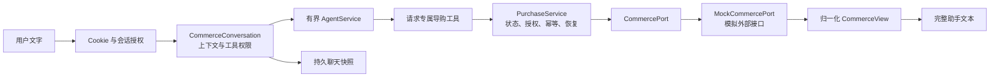

# 公共访客与 Agent 纯文本模拟购买

日期：2026-10-28。本地实现，未部署。历史按钮式链路证据见[第27轮记录](../reviews/public-commerce-results-2026-10-28.json)与[可靠性里程碑](../reviews/public-purchase-milestone-2026-10-28.md)；当前合同以本文为准。公共网站无需注册，`/support/` 工作台保留但不再深化。

## 目标与边界

- 项目目标是验证**Agent 自动导购编排链路**：多轮理解、工具选择、参数绑定、交易状态推进、插问恢复和故障后原操作恢复。
- 商品、购物车、报价、订单和支付由有状态 `MockCommercePort` 模拟成熟外部接口；无真实扣款、真实配送或商业支付接入。
- 全流程只使用公开聊天输入和助手文本；不提供购买按钮、数量输入、购买卡片、付款链接或独立购买操作入口。
- 下单与付款是两次独立、明确、新鲜的文字授权；模型不能自行绕过服务端授权门。

## 身份与数据归属

`POST /api/v1/guest/bootstrap {}` 签发 `rag_guest_session` Cookie，返回访客 UUID、到期时间、私人咨询 ID 和 `session_key`。浏览器持有 Cookie 即代表这位访客，不绑定现实个人；清除 Cookie 后不能凭旧咨询 ID 恢复身份。

Cookie 为 HttpOnly、Secure、SameSite=Lax、Path=/ 的 session cookie。服务端默认七天有效，可通过 `GUEST_SESSION_TTL_SECONDS` 调整；本地 HTTP 才可设置 `GUEST_COOKIE_SECURE=false`。数据库只保存随机令牌 SHA-256。

访客使用内部 `User.is_guest` 主体复用整数 owner，但不能成为管理员，登录/注册查询排除访客。所有请求使用 `credentials: include` 和 `X-Rag-Guest: 1`，写请求核对 Origin。`session_id + session_key` 只定位咨询，Cookie 才是身份；HTTP 与会话门闩内再次核对 owner、private 标记和当前 key。访客路径不继承旧共享 Demo 例外，不采信 body/model 的 `user_id`。

凭据失效返回 401，前端清除旧上下文，由用户明确重新开始；身份存储故障返回 503，不签发替代访客。消息历史仍是 best-effort，不能以空历史判断交易不存在；购买状态由购买域和 mock 外部回执核实。

## Agent 编排



- `CommerceConversation` 在每轮构造请求局部工具 registry，不向旧共享 Demo 图注册购买工具。接受购物任务后先持久提升 automation epoch，再调用模型或工具；模型失败、请求取消或聊天保存失败不能复活旧退款提案。
- `AgentService` 负责理解、规划和实际工具调用。provider 不可用时使用确定性虚拟 planner；两者都执行真实 handler 与 SQL mock，不伪造订单或付款事实。
- 常规工具：检索、SKU 详情、设置 SKU/数量、试算、状态查询。
- 受控工具：`commit_checkout` 与 `mock_pay` 只在当前用户文字明确授权、当前阶段匹配、且该阶段/版本是本会话最新展示的购买快照时注册；handler 再核对 owner、purchase、version、confirmation/payment 和 generation。模型传入 owner、金额、付款成功标记或外来 idempotency key 无效。
- 一回合最多推进一个不可逆阶段。`好的/继续/确认`、否定、疑问、组合的“确认下单并付款”均只澄清或查询，不写入。
- 助手文本由服务端 `CommerceView` 投影：目录、SKU/规格、数量、小计、运费、总价、有效期、订单号、付款号和状态。模型自由文本不能宣布交易成功。

## 持久状态与恢复

购买编排表为 `commerce_purchases/operations/confirmations`；mock 外部表为 `commerce_mock_objects/mock_receipts`。购买只关联 owner，不依赖 ChatSession 外键；清空或删除聊天不取消订单、释放 unknown 操作或删除 mock 外部事实。历史 `commerce_actions` 表保留生产数据但运行时不再读写。

同一访客与商家最多一个活动购买。阶段：shopping、cart、quoted、submitting、unknown、awaiting_payment、processing、paid、failed。当前单商家、CNY、单 SKU、数量 1–10，模拟配送无需真实地址。

购物车和报价先做版本 CAS；报价形成不可变 confirmation。下单按 purchase/generation 预占唯一 order operation，成功后为同一订单创建 payment intent。付款是独立 mock_pay operation。稳定 operation key 绑定 owner、kind 和参数 hash；mock 供应商独立事务保存回执。

unknown/processing 不换 key 重试、不按 TTL 释放、不新开购买。文字“查询订单/查询付款”只核实原 operation 和原 payment；重复明确确认返回当前事实，不产生第二笔交易。报价过期或购物车变更后旧确认失效，必须重新试算并重新展示。清空聊天后旧展示授权失效，需先查询/恢复当前购买再作新确认。

## HTTP 与前端契约

|请求|用途|
|---|---|
|POST `/guest/bootstrap`|Cookie + visitor_id/expires_at/session{id,session_key}|
|POST `/guest/chat`、`/guest/chat/stream`|商品、购物车、报价、下单、付款、查询的唯一公开入口|
|GET、DELETE `/guest/history`|核对原 key；清空轮换 key，不清购买|
|POST `/guest/feedback`|绑定真实完成消息及当前咨询 key|
|GET `/guest/commerce/purchases/active`、`/{purchase_id}`|服务端/测试用只读状态核实，不向前端提供操作|

`CommerceView` 仅是服务端事实投影：schema_version=1、mode=mock、purchase/version/stage/snapshot_at 和 catalog/cart/quote/payment/status blocks；没有 actions/action_ref。前端不解析该结构，也不发起购买专用 POST。

SSE 输出文本帧、可选持久化 completion 和 DONE。completion 必须匹配原 session_key；没有有效 completion 时不显示普通“接收完成”，只提示聊天保存未确认、交易状态需查询。聊天保存失败不回滚业务，也不虚构 message ID。

## 验证

专项：

```sh
.venv/bin/pytest app/tests/unit/services/commerce/test_purchase_workflow.py \
  app/tests/evaluation/test_guest_commerce_flow.py \
  app/tests/evaluation/test_guest_conversations.py \
  app/tests/evaluation/test_commerce_task_fencing.py --no-cov -q
```

覆盖真实本地 SQLite/HTTP/Agent 工具循环、两次独立文字确认、重复确认幂等、跨访客隔离、报价过期、购物车变更、政策插问恢复、接受后超时、processing 和消息保存失败。当前完整门禁已通过：Ruff、格式化、严格 Mypy，后端 **3726 通过/3 配置跳过/5 警告**（核心覆盖 93.57%），前端 **333 Jest + 55 Node**、lint、strict TypeScript 与 12 页构建。真实浏览器已在本地 SQLite + MockCommercePort 上完成目录→选品→报价→文字下单→独立文字付款→查询，未发出购买专用请求且 `commerce_actions` 为 0；第二位访客不能看到第一位订单。完整门禁仍应在变更后重新运行。

本合同不宣称真实支付、真实供应商、生产 PostgreSQL 并发、跨域 Cookie 部署或浏览器支付认证。原[接入评估](conversational-commerce-assessment.md)保留历史设计与未来外部集成要求；其中的按钮/结算页建议已被本文纯文本合同取代。
